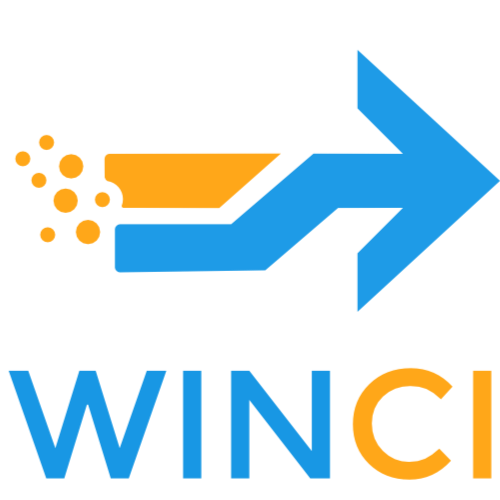

<p align="center">
  
</p>

# WINCI — PC-to-PC Data Crossing

**Version 1.2.0**

Move files and browser data from an **old Windows PC** to a **new one** — two
ways, your choice:

- **Direct cable** — a single Thunderbolt 3/4 or USB4 cable between the PCs.
- **IP address** — any Wi-Fi or Ethernet network; just type the new PC's IP.

Either way there's no cloud and no accounts — the data crosses directly,
**end-to-end encrypted**.

One native Rust program: the transfer core plus a UI drawn with **iced** — or,
on a server over SSH, the same flow as a **terminal UI** you drive with the
keyboard or the mouse (see [Linux server over SSH](#linux-server-over-ssh--terminal-ui)).
No WebView2 and no browser engine. It draws on the GPU (DX12/Vulkan) and falls back
to a CPU renderer by itself when there's no usable GPU (Windows Server, bare
VMs), so it starts everywhere. The log's first lines say which renderer a PC
used (`renderer: …`); set `ICED_BACKEND=tiny-skia` to force the CPU one.

## Branding

- Logo: `app/assets/WINCI.svg` (this page). The app's start screen and window
  icon use `app/icons/128x128@2x.png` / `128x128.png`.
- Icon pack: `app/assets/WINCI.ico` (10 sizes, 16–256 px) — `build.rs` embeds it
  as the exe icon, along with the version info shown in Properties → Details.

---

## How it works

WINCI needs only an IP route between the two PCs, and gets one two ways:

- **Cable**: "Windows Direct Cable Networking" (Thunderbolt Networking /
  USB4NET) exposes the cable as an ordinary network adapter. Both PCs land on
  the same link-local segment (usually `169.254.x.x`) and find each other
  automatically.
- **IP**: on any shared Wi-Fi / Ethernet network, the sender types the IP the
  receiver displays — no cable, no discovery needed.

The transfer protocol is identical on both paths:

```
  OLD PC (send)                         NEW PC (receive)
  ┌───────────────┐   UDP beacon  ◄──── broadcasts { name, tcp_port }
  │ discover_peer │
  │      ↓        │   TCP connect  ────► accept
  │  pair (code)  │   SPAKE2(code) ◄──► PAKE handshake -> session keys
  │      ↓        │   Manifest     ────► create dest tree   (encrypted)
  │  start_send   │   file frames  ────► write files, emit progress
  └───────────────┘                     Documents\WINC Received\crossing-<ts>\
```

- **Discover** — receiver broadcasts a UDP beacon on port `50737`; sender listens.
- **Pair** — new PC shows a 6-digit code; old PC types it. The code drives a
  **SPAKE2** handshake over TCP before any data moves; a wrong code fails the
  handshake cleanly. The connection stays open from pairing through transfer.
- **Connecting by IP** — a first-class path, not a fallback: the sender skips
  discovery and **enters the new PC's IP** by hand (any Wi-Fi / Ethernet
  network). The receiver shows its IP(s); the TCP port is fixed at `50738`, so
  only the IP is needed.
- **Encrypt** — everything after the handshake travels in length-prefixed
  **ChaCha20-Poly1305** AEAD frames with per-direction keys (HKDF-SHA256 from
  the PAKE shared secret). Always on — cable and network alike, no downgrade.
- **Transfer** — length-declared manifest, then chunked file frames (an empty
  frame ends each file, so unreadable files skip cleanly mid-stream). Progress
  is pushed to the UI from whichever side is doing the I/O.

Source of truth for the wire protocol: `app/src/model.rs`, `net.rs`, and
`crypto.rs`; design rationale in `ENCRYPTION_PLAN.md`.

## What transfers

- **Folders** — Documents, Desktop, Pictures, Downloads, Music, Videos, plus any
  folder you add. Sizes are measured live.
- **Browser data** — bookmarks & history, and (opt-in) saved passwords, from
  **12 browsers**:
  - Chromium family: Chrome, Edge, Brave, Vivaldi, Chromium
  - Opera family: Opera, Opera GX
  - Gecko family: Firefox, Zen, LibreWolf, Waterfox, Floorp

> ☁ **OneDrive cloud-only files** ("available online-only" placeholders) can't
> be read without hydrating them. WINCI skips them cleanly mid-transfer instead
> of aborting the crossing.

> ⚠ **Saved passwords are DPAPI-bound.** Chrome/Edge encrypt them against the
> Windows account. The files copy fine but only decrypt if you sign into the new
> PC with the **same Microsoft account**. The UI states this at the point of
> selection — don't remove that warning.
>
> ⚠ **Close the browser before sending its data** — Chrome/Edge lock their SQLite
> files while running, and locked files are skipped.

---

## Project layout

```
app/                     the whole program (one crate, one exe: winci.exe)
  build.rs               embeds the exe icon + version info (Windows)
  installer/winci.iss    Windows installer (Inno Setup: Program Files + Start menu + uninstall)
  installer/appimage.sh  Linux AppImage build (+ winci.desktop)
  assets/, icons/        logo + icons
  src/main.rs            entry: start the log bus, run the UI
  src/backend.rs         everything the UI asks for (pair, send, receive, import…)
                         + session state + the backend → UI event channel
  src/logbus.rs          log fan-out: ring buffer + UI nudge + log file
  src/model.rs           wire types + progress
  src/net.rs             link detection, UDP discovery, TCP transfer
  src/crypto.rs          SPAKE2 handshake + ChaCha20-Poly1305 framed transport
  src/transfer.rs        pipelined file stream + auto-resume (+ its tests)
  src/sources.rs         enumerate + expand folders / browser data
  src/import.rs          receiver "Import into place": dump dir -> real folders/profiles
  src/settings.rs        remembered drop / import folders
  src/ui/mod.rs          app state, messages, update (the step flow)
  src/ui/shell.rs        top bar, role picker, the cable, step rail
  src/ui/steps.rs        one fn per wizard step
  src/ui/logview.rs      activity-log drawer
  src/ui/style.rs        "Signal Bench" palette + widget styles (light & dark)
  src/ui/widgets.rs      text helpers, animated cable, spinner
  src/tui/mod.rs         terminal UI (--tui / SSH): terminal setup, event loop, panic safety
  src/tui/app.rs         its state, messages + update (the same step flow) and key/mouse routing
  src/tui/screens.rs     one fn per step, the terminal versions of ui/steps.rs
  src/tui/view.rs        the frame: top bar, step rail, scrolling body, log panel, modals
  src/tui/kit.rs         layout builder + hit map (every button reachable by click and Tab)
  src/tui/picker.rs      the in-terminal file browser (replaces Explorer's pickers)
  src/tui/input.rs       single-line text fields
archive/react-ui/        the retired React/TypeScript UI (<= 0.8), kept for reference
run.sh                   Linux: build (release, if changed) + run from this checkout
```

---

## Build & run

Everything builds from `app/`. The version lives in one place,
`app/Cargo.toml`; the exe, the window title and both packages read it from
there.

### Windows — exe and installer

**Prerequisites**
- **Rust** (stable, 1.88+) via <https://rustup.rs>
- **Microsoft C++ Build Tools** (MSVC + Windows SDK — `rc.exe` embeds the exe
  icon and version info)
- **Inno Setup 6** (<https://jrsoftware.org/isinfo.php>) — only for the
  installer; add its folder to `PATH` for `iscc`

```powershell
cd app

cargo run                    # debug run
cargo build --release        # -> target\release\winci.exe
iscc installer\winci.iss     # -> target\installer\WINCI-<version>-setup.exe
```

- `winci.exe` alone is the whole app: copy it anywhere and run it.
- The installer puts it in Program Files with a Start-menu entry, an optional
  desktop shortcut and an uninstaller (which also removes WINCI's firewall
  rule). It needs admin rights.
- Uninstall the old Tauri-based WINCI (≤ 0.12) first — it's a separate entry
  in Apps & features.
- Release builds use full link-time optimisation for transfer speed, so the
  final link takes a few minutes.

### Linux — AppImage

**Prerequisites**
- **Rust** (stable, 1.88+) via <https://rustup.rs>
- A C toolchain and `curl` (`sudo apt install build-essential curl`)

```bash
app/installer/appimage.sh    # -> app/target/appimage/WINCI-<version>-x86_64.AppImage
```

The script builds the release binary, lays out the AppDir (binary,
`installer/winci.desktop`, icon) and packs it with `appimagetool`, which it
downloads into `app/target/appimage/` on first run.

- **Build on the oldest distro you want to support** (e.g. Ubuntu 22.04, or a
  container of it). An AppImage only runs where the system glibc is at least
  as new as the build machine's.
- Run it with `chmod +x WINCI-*.AppImage && ./WINCI-*.AppImage`. Systems
  without FUSE 2 need `sudo apt install libfuse2`, or run it with
  `--appimage-extract-and-run`.
- Graphics libraries come from the system; with no Vulkan driver it falls back
  to the CPU renderer. The folder pickers need a desktop portal (GNOME and KDE
  run one).
- WINCI is built for Windows PCs: on Linux the firewall button does nothing and
  the "User Transfer" folders and browser paths are Windows-oriented. Sending
  or receiving plain folders and Custom Transfer picks works.
- The same AppImage runs the terminal UI on a server — see below.

### Linux server over SSH — terminal UI

The same `winci` binary has a terminal UI with the whole flow — Send and
Receive, pairing by cable or IP, User / Custom Transfer, the speed test, Stop,
Import into place and the activity log. It pairs with the window on the other
PC; the wire protocol is the same.

```bash
ssh me@server
./WINCI-1.2.0-x86_64.AppImage --appimage-extract-and-run   # no FUSE on most servers
# or a plain binary: winci
```

**Straight from the source** — if the repo is on the machine, there's no need
for the AppImage. Prerequisites are the same as for the Linux build above
(Rust 1.88+ via <https://rustup.rs>, `sudo apt install build-essential`):

```bash
cd winc-UI
./run.sh                         # builds if the source changed, then runs (release)
./run.sh --tui                   # any WINCI flag passes straight through
```

`run.sh` loads `~/.cargo/env` itself if an SSH shell didn't, and says what's
missing if Rust or a C compiler isn't installed. Or do the same by hand:

```bash
cd winc-UI/app

cargo run --release -- --tui     # build + run in one go (args after `--` go to WINCI)

# or build once, then run the binary directly
cargo build --release            # -> target/release/winci
./target/release/winci --tui

# or install it as `winci` on your PATH (~/.cargo/bin)
cargo install --path .
winci
```

- Over SSH `--tui` is optional — it's picked automatically (see below).
- **Always use `--release` for real transfers.** The release build links with
  full LTO, so the first build takes a few minutes. A debug build (`cargo run`
  without `--release`) compiles faster but encrypts at only a few tens of
  MB/s: the link speed test and every crossing crawl. That's fine for UI work,
  not for moving data. Both PCs count — the slower side sets the pace.

- **Which UI opens** — with no flag, the terminal UI when WINCI is started from
  a terminal over SSH (`SSH_CONNECTION` / `SSH_TTY`, X forwarding included) or
  with no display (`DISPLAY` and `WAYLAND_DISPLAY` unset), the window otherwise.
  `--tui` / `--gui` force one; `--help` lists the flags. A desktop launcher
  always gets the window.
- **Keyboard** — Tab / Shift+Tab or ↑↓ move between buttons, rows and fields;
  Enter or Space presses; PgUp / PgDn / Home / End scroll; Ctrl+L opens the log
  panel; Esc closes it (or a dialog); `q` or Ctrl+C quits — asking first if a
  pairing, transfer or import would be cut off. On the pair step, digits go
  straight into the code.
- **Mouse** — click anything, scroll with the wheel. Works over SSH in any
  terminal with xterm mouse reporting (practically all). Hold **Shift** to
  select text the usual way, e.g. to copy the code or an IP.
- **Picking files and folders** — there's no Explorer over SSH, so pickers open
  an in-terminal browser: ↑↓ / click to move, Enter / → / double-click to open a
  folder, ← / Backspace to go up, Space or a click on `[ ]` to mark, `/` to
  type a path (Tab completes it, `~` works), `.` shows hidden files.
- **Logs** — the panel has the same level and filter as the window. **Copy**
  puts the shown lines on *your* clipboard through the terminal (OSC 52; in
  tmux set `set -g set-clipboard on`). The log file is in
  `~/.local/share/com.winc.app/logs/winc.log`.
- **Terminals** — 80×24 and up. A non-UTF-8 locale (`LANG=C`) switches to
  plain ASCII; `NO_COLOR=1` drops colours.
- **Long transfers** — if the SSH session drops, WINCI goes with it. Run it in
  `tmux` or `screen` to survive a disconnect.
- **No XDG folders** — on servers without a Documents folder, crossings land in
  (and custom picks import into) the home folder.

### Tests

```bash
cd app && cargo test --release   # pairing, resume, damage, stop — over loopback
```

> Written on Linux, where it also builds and runs, but **real testing happens
> on Windows** — that's the only place the Thunderbolt/USB4 adapter and
> browser paths exist.

---

## Windows setup for the direct cable

1. Connect both PCs with a **data-rated** Thunderbolt 3/4 or USB4 cable (not
   charge-only).
2. Windows brings up a **Thunderbolt Networking** / **USB4 Net** adapter
   automatically. If not, enable it in the Thunderbolt Control Center / network
   adapter settings.
3. Allow WINCI through **Windows Firewall** (UDP `50737` for discovery, TCP
   `50738` for transfer). Windows classes the cable link as an *Unidentified*
   (Public) network, where the standard first-run prompt (Private-only) doesn't
   help — if the PCs never find each other, use the **"Allow WINCI through the
   firewall"** button on the Connect step; it adds an all-profiles rule via one
   UAC prompt.
4. Run WINCI on both PCs — **Send** on the old one, **Receive** on the new one.

**No Thunderbolt cable?** Skip all of the above: put both PCs on the same
Wi-Fi / Ethernet network, choose **Receive** on the new PC (it displays its
IP), and on the old PC pick **"No cable — connect by IP"** and type that IP.
Same pairing code, same encryption.

---

## Security notes

- **All traffic is end-to-end encrypted, always** — cable and network alike.
  The 6-digit pairing code feeds a **SPAKE2** PAKE (the Magic Wormhole design),
  so a captured handshake cannot be brute-forced offline; a wrong code allows
  exactly one online guess per connection. The derived secret is split via
  HKDF-SHA256 into per-direction ChaCha20-Poly1305 keys with counter nonces —
  no key/nonce reuse across directions. Frame length is capped at 64 MB and the
  handshake has a 10 s read timeout.
- Incoming paths are sanitized (`net::safe_join`) so a manifest cannot write
  outside the destination folder.
- Saved-password files remain DPAPI-bound to the Windows account (see warning
  above) — WINCI never decrypts them itself.

## Activity log

Every step the app takes — adapter detection, beacon, pairing, each skipped
file, every import decision — is logged. Open it with **Logs** in the top bar
or **Ctrl+L** for a drawer at the bottom (**Expand** makes it taller, **Esc**
closes it). It reads the in-memory ring buffer, so opening it mid-transfer
still shows how things got there.

- **Level** — Info by default. Debug adds per-adapter detail; Trace names
  every file as it moves and every button press / input in the UI. Raising it here also raises it in
  the Rust backend, so those records actually get produced.
- **Log file** — the same lines are appended to
  `%LOCALAPPDATA%\com.winc.app\logs\winc.log` (rotates at 5 MB, one older file kept),
  and the button reveals it in Explorer for "send me the log".
- Logging is **on in release builds**, not just debug — a fault on someone
  else's PC is the case that matters.

---

## Version notes

**1.2.0** (current)
- **Terminal UI for Linux servers over SSH** — the whole send / receive flow
  in a terminal, driven by keyboard *or* mouse. Starts by itself over SSH or
  with no display; `--tui` / `--gui` choose. In-terminal file browser with Tab
  completion instead of Explorer's pickers, log panel with OSC 52 copy, ASCII
  fallback for non-UTF-8 locales, safe terminal restore on exit or a crash.
  Same backend and wire protocol (`WINC4`): a TUI pairs with the window.
- New command-line flags: `--tui`, `--gui`, `--version`, `--help`.
- With no Documents folder (headless Linux), the default drop folder and
  custom-pick imports use the home folder instead of the directory WINCI was
  started from. Import notes show the platform's path separator.

**1.1.1**
- Diagnosing "data arrived damaged": when a frame fails its integrity check,
  the receiver now tests it against nearby file/chunk positions and logs
  either *"belongs to file #N chunk #M … the PCs disagree about frame order"*
  (a bug in WINCI) or *"matches no nearby position: its bytes were altered in
  transit"* (the network path).
- New test: 15k small files over a choppy, paused link.

**1.1.0**
- Linux AppImage build: `app/installer/appimage.sh`; README build steps for
  both platforms.
- The Done page shows how long the transfer took and the average speed
  ("Took 3m 05s · average 412 MB/s"), and the log records it. Timed from
  *Start transfer* (receiver: the sender connecting) to the last file.

**1.0.2**
- The spinner is gone: waiting lines show animated dots (".", "..", "...")
  stepping 2.5× a second. On a Hyper-V Server 2019 VM (no GPU) the spinner
  alone used ~80% CPU.
- With no hardware GPU (WARP, llvmpipe or the CPU renderer — see the log's
  `renderer:` line) the flowing cable animates at 4 fps instead of 30.

**1.0.1**
- Smooth scrolling: draws on the GPU again (wgpu), keeping the CPU renderer
  as the automatic fallback. CPU-only scrolling cost ~60 ms per step and lagged
  on high-DPI screens.
- The spinner and the cable animate on their own instead of rebuilding the
  whole window 30× a second, and no longer leave trails (the spinner's ring smear).
- The log records the renderer, GPU, OS and CPU at startup.

**1.0.0**
- **New native UI — no WebView2.** The Tauri + Leptos webview front end is gone;
  the UI is now drawn by **iced** on the CPU, in the same program as the
  transfer core. Fixes "Could not find the WebView2 Runtime" on Windows Server
  and older/locked-down PCs; also needs no GPU/OpenGL driver.
- Same flow and look (Signal Bench palette, live cable, step rail, light/dark
  follows Windows). Differences: no drop shadows, the log drawer has
  **Expand** instead of a pop-out window, and the cable reads
  *Linked · network* when paired over Wi-Fi / Ethernet.
- Ships as a single `winci.exe`; optional Inno Setup installer in
  `app/installer/`. Settings and the log
  file stay where earlier versions kept them.
- Wire protocol unchanged (`WINC4`) — pairs with 0.12.x.

**0.12.0**
- Pipelined transfer engine (parallel encrypt/decrypt, 4 reader + 4 writer
  threads, 1 MB frames, 4 MB socket buffers) and a **Test link speed** button.
  Wire protocol `WINC4`.

**0.11.0**
- **Auto-resume** — if data arrives damaged (fails its integrity check) or the
  connection drops mid-transfer, the receiver keeps listening, the sender
  reconnects with the same pairing code, and the transfer picks up at the file
  that was in flight; nothing already received is sent again. Retries back off
  for up to 2 minutes; damage that keeps hitting the same file (4×) or more
  than 30 resumes ends the transfer with a clear error instead of looping.
  The UI shows *Reconnecting…* and Stop still works. Disk-side failures
  (drive full, can't create a file) are not retried.
- The sender only reports success once the receiver confirms the last file.
- New `transfer.rs` holds the file stream + resume; tests break the link on
  purpose through a fault-injecting proxy (`cargo test --lib`).
- Wire protocol bumped to `WINC3` — **both PCs must run 0.11.0**.

**0.10.2**
- Fixed a UI crash (`TypeError … reading 'length'`) when Chromium fired a
  key event with no key — e.g. picking an autofill suggestion in the IP field.
- Stress test now mirrors a real web-project crossing (30k files, ~3.5 GB).

**0.10.1**
- Mid-transfer decrypt failures no longer say "code mismatch" — that's only
  true during pairing. After the manifest, it means the data was altered in
  transit; the error now says so and names the file, and the log records the
  frame number and how far in it happened.
- Added an opt-in multi-file stress test (`cargo test --lib -- --ignored stress`).

**0.10.0**
- **Choose where data lands (receiver)** — the code screen shows where incoming
  files go (default `Documents\WINC Received`) with the drive's free space, and
  **Change folder…** points it at any folder/drive. Remembered between runs
  (`settings.json` in the app config dir). A transfer that won't fit is stopped
  up front with a clear message instead of failing part-way.
- **Choose where Import puts it** — the Done screen imports into *Your user
  folders* (as before) or *A folder you choose* (`<folder>\Documents`,
  `<folder>\Desktop`, … and custom picks straight in). The last folder is
  pre-selected next time. Browser data still goes to the browsers.
- **Pop-out log fix** — the log window opened blank and couldn't be closed on
  Windows: it was created from a synchronous command, which deadlocks there.
- Log level dropdown is readable in dark mode.

**0.9.2**
- **Blank-window fix** — the packaged app showed an empty window: the log bus
  started a background task before the UI mounted, which panics in Leptos.
  It now starts after mount. Demo mode never hit this path.
- **Startup error reporter** — if the UI ever fails to start, the error is shown
  in the window and written to `winc.log` (`ui::boot`) instead of a blank screen.

**0.9.1**
- **Large-transfer timeout fix** — after pairing, the sender used to stay
  silent through the folder scan, the user's choice and the file-list build;
  on big PCs that idle gap got the connection dropped before any data moved.
  The sender now pings every 10 s until the transfer starts, the file list is
  sent in 20,000-entry chunks (no single-frame size cap), and file sizes come
  from the first walk instead of a second stat per file. The receiver reports
  a clear error if the old PC goes silent for 2 minutes before the transfer.
- Wire protocol bumped to `WINC2` — **both PCs must run 0.9.1**.

**0.9.0**
- **UI rewritten in Rust** with Leptos (CSR/wasm) in `ui/`. Same markup, class
  names and CSS, so the app looks identical; npm now only provides the Tauri
  CLI. The React UI is archived in `archive/react-ui/`.

**0.8.0**
- **Custom Transfer** — the sender's payload step now chooses between
  **User Transfer** (the preset folders + browsers) and **Custom Transfer**
  (any files and folders picked in Explorer, from any drive). Picks travel as
  `Custom/<name>` and import into `Documents\<name>`.

**0.7.0**
- **Activity log** — in-app drawer (Ctrl+L) and detachable window, backed by a
  ring buffer + rotating log file in the Rust backend (`logbus.rs`). Backend and
  UI both log; failures that the flow used to swallow now show up.

**0.6.1**
- Rebranded to **WINCI**: new logo (`src/assets/WINCI.svg`) and full icon pack
  (`src/assets/WINCI.ico` → `src-tauri/icons/`) used by the built app and
  installer; product name / window title / UI copy updated.
- Copy now presents the two connection paths — **Thunderbolt/USB4 cable** and
  **IP over Wi-Fi/Ethernet** — as equal options throughout the UI and README.
- (Data folder remains `Documents\WINC Received` — unchanged for
  compatibility with earlier crossings.)

**0.6.0**
- **Overwrite?** — browser imports skipped as "not fresh" now show an
  Overwrite? button in the report. Forcing it first backs the new PC's
  existing files up to `WINC Received\crossing-<ts>\Backup\<Browser>\`,
  then replaces them; if any backup fails, nothing further is overwritten.
- **Snapshot log** — every import run writes `import-log-<ts>.json` in the
  crossing folder recording each file's source → destination and outcome
  (`copied` / `kept-both` / `backed-up` / `overwrote` / `failed`), so any
  import can be traced or undone by hand.

**0.5.0**
- **Select all** — one-click select/deselect of every source group on the
  sender's payload step.
- **Import into place** — new button on the receiver's Done screen moves the
  crossing out of `Documents\WINC Received` into the real user folders and,
  when safe, into installed browsers (`import.rs`). Rules: nothing is ever
  overwritten (duplicates kept as "name (from old PC)"); custom folders land
  in `Documents\<name>`; browser data imports only into a browser with no
  existing data — otherwise skipped with a "sign in and sync" hint. Per-group
  results shown as a report.

**0.4.2**
- UI-freeze fix: long-running commands (`receive`, `start_send`, `pair`,
  `discover_peer`, `list_sources`, `allow_firewall`) were synchronous, and
  Tauri v2 runs sync commands on the main thread — the receiver froze
  ("Not Responding") from accept through the whole transfer, never rendered
  `winc://paired`/`winc://progress`, and stayed stuck on the code screen while
  data landed. All now `async` + `spawn_blocking`, so both windows stay live
  and show progress.

**0.4.1**
- Cable detection fix: adapters are now enumerated via `GetAdaptersAddresses`
  (ipconfig crate) instead of if-addrs, which only reported adapters that
  already held an IPv4 address — the Thunderbolt/USB4 P2P adapter is IPv6-only
  for its first ~5–30 s after link-up (DHCP timeout before APIPA), so the
  plugged-in cable was invisible. The UI now shows "cable detected, waiting
  for address" during that window, plus a manual static-IP tip if APIPA never
  arrives.

**0.4.0**
- End-to-end encryption: SPAKE2 pairing-code handshake + ChaCha20-Poly1305
  framed transport, always on (`crypto.rs`).
- Browser support expanded from 3 to 12: added Brave, Vivaldi, Chromium,
  Opera, Opera GX, Zen, LibreWolf, Waterfox, Floorp.
- Cable patch: one-click "Allow WINC through the firewall" (all profiles,
  fixes the Unidentified/Public-network block that broke discovery).
- OneDrive patch: chunked file framing; cloud-only placeholders and other
  unreadable files skip cleanly mid-transfer.
- Receiver fix: "Start over" now unblocks the accept loop, stops the beacon,
  and clears leftover session state, so re-pairing works.

**0.1.0** — initial release: Thunderbolt/USB4 direct-cable transfer, UDP
discovery, 6-digit pairing, manual-IP fallback, Chrome/Edge/Firefox data.

## Status

Frontend: complete, typechecks, builds. Rust core: complete and written to
standard APIs; compile/run happens on the Windows build machine (no Rust
toolchain on the authoring box).
